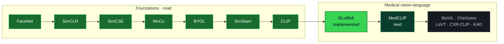

<div align="center">


<!-- Make sure this file is committed to the repo root. Tip: rename it without spaces, e.g. portfolio-banner.png -->


<a href="https://git.io/typing-svg">
  
</a>

<br/>

<a href="https://ahsanhabibkushal.vercel.app/"></a>
<a href="https://github.com/AhsanCS64"></a>
<a href="https://huggingface.co/Archmage64"></a>
<a href="https://www.linkedin.com/in/h-m-ahsan-habib-kushal-0263731a1/"></a>
<a href="mailto:kushalahsan@gmail.com"></a>

<br/>


<br/><br/>

<sub>
<a href="#-about-me">About</a> ·
<a href="#-focus-areas">Focus</a> ·
<a href="#-featured-projects">Projects</a> ·
<a href="#-current-research">Research</a> ·
<a href="#%EF%B8%8F-technical-toolkit">Toolkit</a> ·
<a href="#-github-activity">Activity</a> ·
<a href="#-education--achievements">Education</a> ·
<a href="#-certifications">Certifications</a> ·
<a href="#-lets-connect">Connect</a>
</sub>

<br/><br/>

<table>
  <tr>
    <td align="center" width="150"><h2>3.76</h2><sub><b>CGPA / 4.00</b></sub></td>
    <td align="center" width="150"><h2>2nd</h2><sub><b>in class</b></sub></td>
    <td align="center" width="150"><h2>4th</h2><sub><b>BAIC 2025</b></sub></td>
    <td align="center" width="150"><h2>8</h2><sub><b>projects shipped</b></sub></td>
    <td align="center" width="150"><h2>8</h2><sub><b>papers read</b></sub></td>
    <td align="center" width="150"><h2>4</h2><sub><b>certifications</b></sub></td>
  </tr>
</table>

</div>


## 👋 About Me

I'm a Computer Science and Engineering undergraduate at the **National Institute of Textile Engineering and Research (NITER), University of Dhaka**, with a CGPA of **3.76 / 4.00**.

I build and deploy practical software systems, explore deep learning and applied AI, and enjoy turning messy, real-world problems into useful solutions. My work spans full-stack engineering, backend systems, relational databases, and natural language processing.

```python
from dataclasses import dataclass, field


@dataclass
class Archmage:
    name: str = "H. M. Ahsan Habib Kushal"
    school: str = "NITER, University of Dhaka"
    focus: list = field(default_factory=lambda: [
        "Deep Learning", "Applied AI/ML", "NLP", "Software Engineering",
    ])
    beyond: list = field(default_factory=lambda: [
        "Competitive Programming", "Science Community", "Technical Learning",
    ])
    path: str = "Curiosity → Knowledge → Understanding → Mastery"

    def today(self) -> str:
        return "Learning the theory. Engineering the solution."
```

<table>
<tr><td>🔭 <b>Working on</b></td><td>Medical vision-language learning (GLoRIA) and robust Bangla NLP</td></tr>
<tr><td>🌱 <b>Reading next</b></td><td>MedCLIP</td></tr>
<tr><td>💬 <b>Ask me about</b></td><td>Deep learning, Bangla NLP, full-stack engineering, competitive programming</td></tr>
<tr><td>📫 <b>Reach me</b></td><td><a href="mailto:kushalahsan@gmail.com">kushalahsan@gmail.com</a></td></tr>
</table>

<div align="center">


</div>


## 🔭 Focus Areas

<table>
<tr>
  <td width="25%" valign="top" align="center"><h3>🧠</h3><b>Contrastive Learning</b><br/><sub>Representation learning and how it improves downstream robustness</sub></td>
  <td width="25%" valign="top" align="center"><h3>🇧🇩</h3><b>Robust Bangla NLP</b><br/><sub>Reliable language models and evaluation for Bangla text</sub></td>
  <td width="25%" valign="top" align="center"><h3>🧪</h3><b>End-to-End ML</b><br/><sub>Reproducible pipelines, honest baselines and rigorous evaluation</sub></td>
  <td width="25%" valign="top" align="center"><h3>🏗️</h3><b>Production Engineering</b><br/><sub>APIs, relational data modelling and migrations that hold up in the real world</sub></td>
</tr>
</table>


## 🚀 Featured Projects

### 🧠 AI & Machine Learning

<table>
  <tr>
    <td colspan="2" valign="top">
      <h3>🔬 HeadlineGuard BD <sup>Flagship</sup></h3>
      <sub><b>Research · NLP · Deployed</b></sub><br/><br/>
      Bangla <b>clickbait detection</b> comparing classical ML, recurrent networks and <b>BanglaBERT</b>. Validation macro F1 on the same split:
      <pre>BanglaBERT  ████████████████░░░░  0.8032
Linear SVM  ███████████████▌░░░░  0.7786</pre>
      
      
      
      <br/><br/>
      <a href="https://headlineguardbd.streamlit.app/"></a>
      <a href="https://huggingface.co/Archmage64/HeadlineguardBD"></a>
      <a href="https://github.com/AhsanCS64/HeadlineGuard_BD"></a>
    </td>
  </tr>
  <tr>
    <td width="50%" valign="top">
      <h3>🧠 MindScope</h3>
      <sub><b>Explainable ML · Interactive App</b></sub><br/><br/>
      Explore student survey data and see how individual features contribute to the recorded-label prediction from a five-model <b>XGBoost</b> ensemble, with <b>SHAP</b> explanations.<br/><br/>
      
      
      
      <br/><br/>
      <a href="https://mind-scope-tau.vercel.app/#overview"></a>
      <a href="https://github.com/AhsanCS64/MindScope"></a>
    </td>
    <td width="50%" valign="top">
      <h3>🎮 GameSense V2</h3>
      <sub><b>Machine Learning · Recommendation System</b></sub><br/><br/>
      The advanced version of my game recommender: discover games from one favorite title, or combine several liked games to get recommendations that reflect your tastes.<br/><br/>
      
      <br/><br/>
      <a href="https://gamesense-v2.streamlit.app/"></a>
      <a href="https://github.com/AhsanCS64/GameSenseV2"></a>
    </td>
  </tr>
  <tr>
    <td colspan="2" valign="top">
      <h3>💧 LYKORA <sup>Concept</sup></h3>
      <sub><b>Sustainability · Applied AI</b></sub><br/><br/>
      <b>Water intelligence</b> for the garment industry, including ETP monitoring and anomaly detection.<br/><br/>
      
      
      
    </td>
  </tr>
</table>

### 🏗️ Full-Stack & Systems

<table>
  <tr>
    <td width="50%" valign="top">
      <h3>🏠 CTRx — Central Tenancy Records</h3>
      <sub><b>Backend · Trust &amp; Transparency</b></sub><br/><br/>
      Verifiable <b>rental histories</b> that build transparency and trust between tenants and landlords.<br/><br/>
      
      
      
      <br/><br/>
      <a href="https://ctrx-chi.vercel.app/"></a>
      <a href="https://github.com/AhsanCS64/CTRx"></a>
    </td>
    <td width="50%" valign="top">
      <h3>🐄 KhamarBari</h3>
      <sub><b>Full-Stack · Agri-Tech</b></sub><br/><br/>
      Industrial-scale <b>farm management</b> covering livestock, poultry, fisheries, workforce, expenses, orders and production.<br/><br/>
      
      
      
      <br/><br/>
      <a href="https://khamar-bari-v2-rho.vercel.app/"></a>
      <a href="https://github.com/AhsanCS64/KhamarBari_v2"></a>
    </td>
  </tr>
  <tr>
    <td width="50%" valign="top">
      <h3>🏥 CMRx — Central Medical Records</h3>
      <sub><b>Web · Healthcare</b></sub><br/><br/>
      <b>Medical records</b> management and disease tracking.<br/><br/>
      
      <br/><br/>
      <a href="https://cmrx.rf.gd/cmrx/Homepage.php"></a>
    </td>
    <td width="50%" valign="top">
      <h3>🏭 FACTIV</h3>
      <sub><b>Web · Industry</b></sub><br/><br/>
      <b>Garment-factory management</b> with role-based operational modules.<br/><br/>
      
      
      <!-- TODO: add <br/><br/><a href="REPO_OR_DEMO_URL">…</a> -->
    </td>
  </tr>
</table>

<div align="center">

<a href="https://github.com/AhsanCS64?tab=repositories"></a>

</div>


## 🔬 Current Research

### GLoRIA · Medical vision-language learning

I completed an initial Kaggle implementation of **GLoRIA** to study how chest radiographs align with reports at two levels: the whole image and report, and individual image regions and words.

<!-- TODO: add your Kaggle notebook link here -->
📓 Kaggle run · 💻 [GLoRIA source](https://github.com/marshuang80/gloria)

My reading path, from contrastive foundations to medical vision-language pre-training:



<table>
<tr><th align="left">Status</th><th align="left">Papers</th></tr>
<tr><td>✅ Foundational papers read</td><td>FaceNet, SimCLR, SimCSE, MoCo, BYOL, SimSiam, CLIP</td></tr>
<tr><td>🧪 Read and initially implemented</td><td>GLoRIA</td></tr>
<tr><td>📌 Next to read</td><td>MedCLIP</td></tr>
<tr><td>🔭 Further reading targets</td><td>BioViL, CheXzero, LoVT, CXR-CLIP, KAD</td></tr>
</table>


## 🛠️ Technical Toolkit

<table>
<tr>
  <td width="20%"><b>💻 Languages</b></td>
  <td> </td>
</tr>
<tr>
  <td><b>🧠 AI / Data</b></td>
  <td>    </td>
</tr>
<tr>
  <td><b>🌐 Web / Backend</b></td>
  <td></td>
</tr>
<tr>
  <td><b>🗄️ Databases / Tools</b></td>
  <td></td>
</tr>
</table>


## 📈 GitHub Activity

<div align="center">

<picture>
  <source media="(prefers-color-scheme: dark)" srcset="https://github-readme-stats.vercel.app/api?username=AhsanCS64&show_icons=true&hide_border=true&bg_color=0D1117&title_color=39D353&icon_color=39D353&text_color=C9D1D9&rank_icon=github" />
  
</picture>
<picture>
  <source media="(prefers-color-scheme: dark)" srcset="https://github-readme-stats.vercel.app/api/top-langs/?username=AhsanCS64&layout=compact&hide_border=true&bg_color=0D1117&title_color=39D353&text_color=C9D1D9" />
  
</picture>

<br/>

<picture>
  <source media="(prefers-color-scheme: dark)" srcset="https://streak-stats.demolab.com?user=AhsanCS64&theme=dark&hide_border=true&background=0D1117&ring=39D353&fire=39D353&currStreakLabel=39D353" />
  
</picture>

<br/>

<picture>
  <source media="(prefers-color-scheme: dark)" srcset="https://github-readme-activity-graph.vercel.app/graph?username=AhsanCS64&bg_color=0D1117&color=39D353&line=238636&point=58A6FF&area=true&hide_border=true" />
  
</picture>

</div>


## 🎓 Education & Achievements

<table>
<tr><th align="left">Achievement</th><th align="left">Details</th></tr>
<tr><td>🎓 <strong>B.Sc. in Computer Science and Engineering</strong></td><td>National Institute of Textile Engineering and Research (NITER), University of Dhaka</td></tr>
<tr><td>📊 <strong>CGPA 3.76 / 4.00</strong></td><td>2nd in class</td></tr>
<tr><td>🏆 <strong>4th Place — BAIC 2025</strong></td><td>Senior category</td></tr>
<tr><td>🧪 <strong>Organizing Secretary</strong></td><td>NITER Science Society</td></tr>
<tr><td>💻 <strong>Deputy Treasurer</strong></td><td>NITER Computer Club</td></tr>
</table>


## 📜 Certifications

<table>
<tr><th align="left">Certification</th><th align="left">Issuer</th><th align="left">Year</th></tr>
<tr><td>🧠 <strong>Deep Learning Specialization</strong></td><td>DeepLearning.AI · Andrew Ng</td><td>2026</td></tr>
<tr><td>🤖 <strong>Machine Learning Specialization</strong></td><td>DeepLearning.AI · Andrew Ng</td><td>2026</td></tr>
<tr><td>🔥 <strong>PyTorch Professional Certificate</strong></td><td>DeepLearning.AI</td><td>2026</td></tr>
<tr><td>📊 <strong>IBM Data Science Professional Certificate</strong></td><td>IBM</td><td>2026</td></tr>
</table>


## 🌱 What I'm Working Toward

Building reliable AI-powered applications, strengthening the fundamentals behind modern machine learning, and contributing to software that solves real-world problems.

- [x] Ship full-stack systems across Python, JavaScript and PHP ecosystems
- [x] Build a strong ML foundation through structured, project-backed coursework
- [x] Deploy MindScope with interactive predictions and SHAP explanations
- [ ] Explore contrastive learning in depth through end-to-end experiments
- [ ] Publish rigorous research on robust Bangla NLP


## 🤝 Let's Connect

I'm always happy to talk about deep learning, Bangla NLP, software engineering, or competitive programming — and I'm open to **collaborations, research projects and internships**.

<div align="center">

<a href="mailto:kushalahsan@gmail.com"></a>
<a href="https://www.linkedin.com/in/h-m-ahsan-habib-kushal-0263731a1/"></a>

<br/><br/>

<a href="https://git.io/typing-svg"></a>

<br/>

<a href="https://ahsanhabibkushal.vercel.app/">Portfolio</a> ·
<a href="https://github.com/AhsanCS64?tab=repositories">Repositories</a> ·
<a href="https://huggingface.co/Archmage64">Hugging Face</a>

<sub>Made with curiosity, code, and a little magic. 🪄</sub>


</div>
